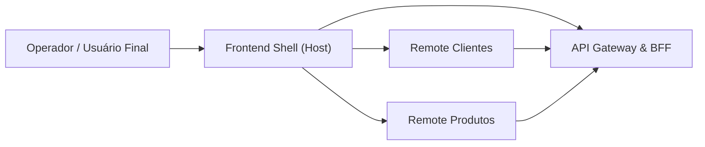
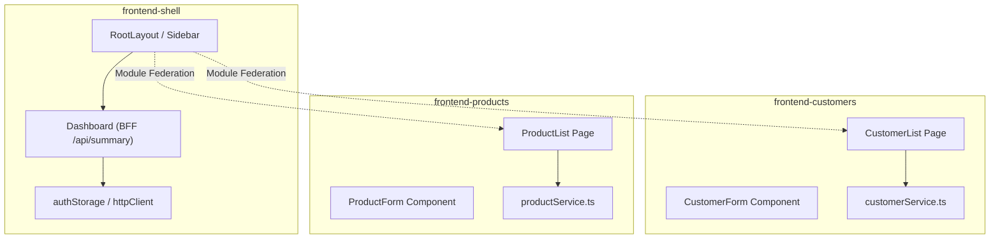
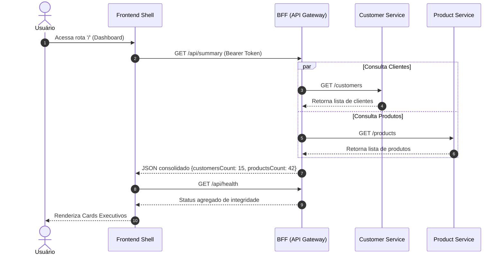
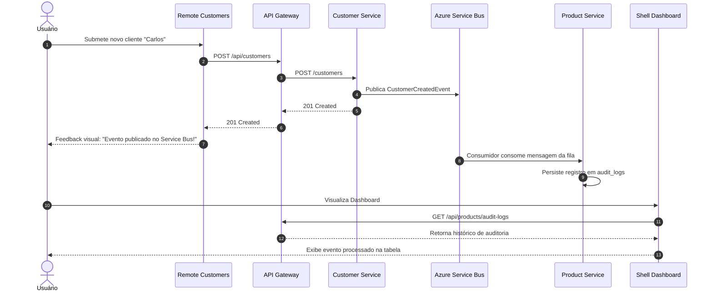

# Documentação Arquitetural Arc42 — Frontend Microfrontends (Module Federation)

---

## 1. Introdução e Metas

### 1.1 Objetivos de Negócio
O projeto de frontend tem como missão prover uma interface web moderna para o sistema empresarial **CRMaster**. A solução adota o padrão **Microfrontends (MFE)** com **Vite** e **Module Federation**, permitindo a entrega independente dos domínios funcionais de clientes e produtos, orquestrados por uma casca principal (**Shell**).

### 1.2 Metas de Qualidade
* **Componibilidade & Desacoplamento:** Cada MFE (`frontend-customers`, `frontend-products`) é desenvolvido e testado isoladamente.
* **Consistência de Estado e Segurança:** O Shell orquestra a sessão do usuário, garantindo a injeção centralizada de tokens JWT em todas as requisições ao Backend-For-Frontend (BFF).
* **Desempenho e Carregamento Rápido:** Carregamento sob demanda (*lazy loading*) via Module Federation com tempo de renderização inicial reduzido.

---

## 2. Restrições Arquiteturais

| Restrição | Descrição |
| :--- | :--- |
| **Tecnologia Base** | React 19, TypeScript e Tailwind CSS v4. |
| **Bundler & Federation** | Vite com `@module-federation/vite`. |
| **Hospedagem em Nuvem** | Azure Static Web Apps com Nginx localmente para fallback de SPA. |
| **Acesso a Dados** | Apenas consumo HTTP via API Gateway & BFF (`/api/*`), sem nunca contatar microsserviços diretamente. |

---

## 3. Contexto e Escopo

### 3.1 Contexto de Negócio
O usuário final interage através do navegador com o **Frontend Shell**, que renderiza dinamicamente as páginas remotas de clientes e produtos e consolida métricas no Dashboard.

### 3.2 Contexto Técnico
O Shell carrega os módulos remotos via manifestos `remoteEntry.js` em runtime. As chamadas REST utilizam o cliente HTTP centralizado com interceptor de autenticação Bearer JWT.

---

## 4. Estratégia de Solução

* **Module Federation:** Separação de responsabilidades de UI em três módulos independentes:
  * `frontend-shell` (Porta 5173 / Host): Layout raiz, navegação, autenticação e Dashboard BFF.
  * `frontend-customers` (Porta 5174 / Remote): Listagem, cadastro e feedback visual de eventos assíncronos.
  * `frontend-products` (Porta 5175 / Remote): Catálogo comercial de produtos e visualização de auditoria.
* **Cliente HTTP Padronizado com Interceptor:** `httpClient` e `authStorage` centralizados que injetam `Authorization: Bearer <token>` em todas as requisições.

---

## 5. Visão dos Blocos de Construção

### Nível 1: Visão Geral de Microfrontends

### Nível 2: Estrutura Interna de Cada MFE
* `components/core`: Botões, inputs, grids e ícones atômicos.
* `components/base`: Sidebar, Header, Table e Layouts.
* `pages/`: Telas e orquestração de formulários.
* `services/`: Cliente HTTP e adaptadores de integração com o Gateway.

---

## 6. Visão de Execução

### 6.1 Carregamento Agregado do Dashboard (BFF)

### 6.2 Disparo e Rastreamento de Mensageria Assíncrona

---

## 7. Visão de Implantação

* **Azure Static Web Apps:** Hospedagem em CDN global de alta disponibilidade. O pipeline copia os bundles compilados dos remotes para dentro da pasta `public/` do Shell antes do build final, garantindo rotas relativas robustas.
* **Ambiente Docker Local:** Cada MFE roda em um container Nginx alpine leve com portas mapeadas (`5173`, `5174`, `5175`).

---

## 8. Conceitos Transversais

* **Segurança Centralizada:** Armazenamento do token JWT em `localStorage` e inserção transparente em todos os cabeçalhos de requisição.
* **Fitness Functions de Arquitetura:** Execução do `dependency-cruiser` impedindo dependências circulares e acoplamento entre páginas e componentes.
* **Testes Automatizados:** Suíte com `vitest` e `@testing-library/react` para páginas, formulários e serviços.

---

## 9. Decisões Arquiteturais (ADRs)

* **ADR-FE-01: Adoção de Microfrontends com Vite e Module Federation**
  * *Contexto:* Necessidade de permitir times independentes de desenvolvimento para Clientes e Produtos.
  * *Decisão:* Adotar Module Federation em vez de monólito SPA.
* **ADR-FE-02: Consumo Exclusivo do API Gateway / BFF**
  * *Contexto:* Evitar que o frontend precise conhecer portas ou endereços IP dos microsserviços.
  * *Decisão:* Toda e qualquer chamada é prefixada com `/api/*` direcionada ao Gateway.

---

## 10. Requisitos de Qualidade (ATAM & ISO/IEC 25010)

| ID | Atributo | Cenário ATAM (6 Partes) |
| :--- | :--- | :--- |
| **QA-FE-01** | **Desempenho** | **Fonte:** Usuário na rede móvel. **Estímulo:** Acessa o Dashboard. **Artefato:** Shell e BFF. **Ambiente:** Normal. **Resposta:** Retorna métricas agregadas em menos de 1 segundo. **Medida:** Renderização do resumo em < 1000ms. |
| **QA-FE-02** | **Segurança** | **Fonte:** Usuário sem credencial. **Estímulo:** Tenta chamar rota protegida. **Artefato:** httpClient. **Ambiente:** Produção. **Resposta:** Rejeição 401 e solicitação de login. **Medida:** Nenhuma chamada não autenticada passa com sucesso. |

---

## 11. Riscos e Dívidas Técnicas

* **Risco de Versionamento em Remotes:** Incompatibilidade entre versões de contratos de componentes exportados. Mitigado através de contratos TypeScript estritos e testes de arquitetura.
* **Cold Start no primeiro carregamento do MFE:** Mitigado por carregamento assíncrono via `Suspense` com fallbacks amigáveis.

---

## 12. Glossário

* **Host / Shell:** Aplicação principal que carrega os módulos remotos federados.
* **Remote:** Módulo federado que expõe componentes e páginas para o Host.
* **BFF (Backend-For-Frontend):** Padrão de agregação onde o Gateway fornece endpoints sob medida para a tela do cliente.
